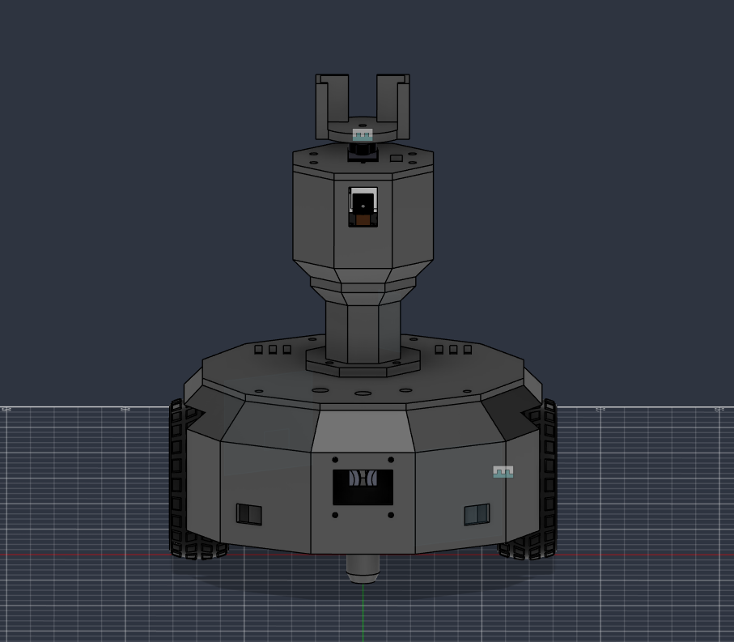
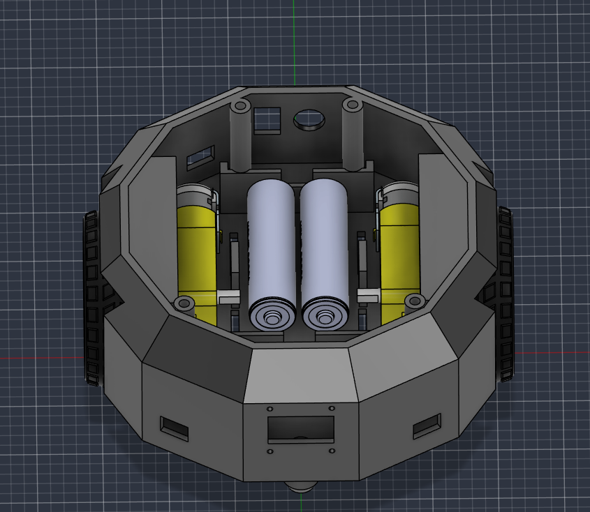
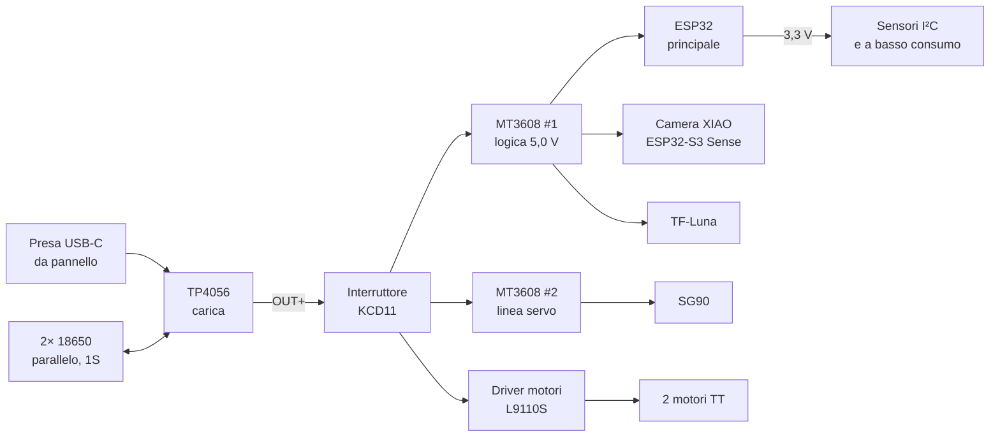
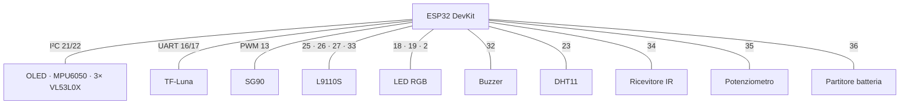

# 🛡️ Sentinel Robot Mini

### Un piccolo robot autonomo da interno che pattuglia la casa, costruito da zero un sensore alla volta

*Basato su ESP32, completamente stampato in 3D, pensato per la sicurezza domestica e aperto a molto altro.*

 

-FF6B00?style=for-the-badge&logo=autodesk&logoColor=white&labelColor=555)

[English](README.md) · **Italiano**

---

<!-- Sostituisci con le tue immagini (cartella consigliata: docs/images/) -->

  
  
  

<i>Render CAD · robot montato · interno (in lavorazione)</i>

---

## ✨ Cos'è

**Sentinel Robot Mini** è un robot autonomo compatto (circa 18 cm di larghezza) che pattuglia gli spazi interni. Gira per la casa, evita gli ostacoli, trasmette video in diretta sulla sua rete Wi-Fi e controlla l'ambiente.

La sicurezza domestica è l'uso principale, ma il robot è pensato come una **piattaforma generica**: sensori, alimentazione e firmware sono modulari, così si possono aggiungere nuove funzioni senza riprogettare l'hardware.

## 🎯 Obiettivi

- **Imparare la robotica sul serio**: progettazione meccanica, elettronica di potenza, sensori e firmware, con ogni scelta testata e misurata invece che data per scontata.
- **Costruire un prototipo funzionante di sicurezza domestica**: pattuglia autonoma, camera in diretta, monitoraggio dell'ambiente.
- **Renderlo espandibile**: una base che possa crescere in altri progetti.

## 🧭 Funzioni

| Funzione | Stato |
|---|---|
| Video in diretta sulla rete Wi-Fi del robot | 🔧 Nuova scheda camera, in test |
| Testa rotante con camera e lidar a lunga distanza | ✅ Servo testato |
| Rilevamento ostacoli a corto raggio (3 sensori laser a tempo di volo) | ✅ Tutti e 3 montati |
| Orientamento (giroscopio + accelerometro) | ✅ Testato |
| Display OLED di stato | ✅ Testato |
| Batteria ricaricabile via USB-C | ✅ Funziona |
| Monitoraggio della temperatura e reazione | 📝 Previsto |
| Pattuglia autonoma | 📝 Previsto |
| Rilevamento del movimento | 📝 Previsto |
| Rilevamento di suoni e rumori (microfono integrato) | 📝 Previsto |
| Telecomando IR | 📝 Previsto |
| Aggiornamenti OTA per la camera | 📝 Previsto |

## 🔩 Hardware

### I sensori e a cosa servono

| Sensore | Ruolo |
|---|---|
| **TF-Luna** (lidar) | Distanza a lungo raggio, su una corona rotante per scansionare la stanza |
| **3× VL53L0X** (laser a tempo di volo) | Ostacoli a corto raggio: davanti destra, davanti sinistra, dietro |
| **MPU6050** (IMU) | Direzione e angoli di rotazione |
| **OV2640** su XIAO ESP32-S3 Sense | Video in diretta |
| **Microfono digitale** su XIAO ESP32-S3 Sense | Rilevamento di suoni e rumori |
| **DHT11** | Temperatura e umidità |
| **VS1838B** | Ricevitore del telecomando IR |
| **Potenziometro** | Limite manuale della velocità massima (tutto a sinistra = fermo) |

### Lista componenti

| Q.tà | Componente | Note |
|:-:|---|---|
| 1 | ESP32 DevKit (WROOM) | Controller principale |
| 1 | Seeed Studio XIAO ESP32-S3 Sense (OV2640, microfono digitale, 8 MB PSRAM) | Nella testa: video e audio |
| 1 | Lidar TF-Luna | UART, sulla corona rotante |
| 1 | Micro servo SG90 | Gira la testa e la corona del lidar |
| 2 | Motori TT + ruote da 65 mm | Trazione differenziale, carreggiata 130 mm |
| 1 | Driver motori L9110S | |
| 1 | Ruota a sfera CY-12A | Appoggio posteriore |
| 3 | Moduli VL53L0X | Su adattatori inclinati stampati in 3D |
| 1 | MPU6050 | I²C |
| 1 | OLED SSD1306 128×64 | I²C |
| 1 | DHT11 | |
| 1 | Ricevitore IR VS1838B | |
| 1 | Potenziometro | |
| 1 | LED RGB + 3 resistenze da 220 Ω | Luce di stato |
| 1 | Buzzer | |
| 2 | Celle Li-ion 18650 | In parallelo (1S) |
| 1 | Modulo di carica TP4056 USB-C | |
| 2 | Convertitori boost MT3608 | Linea logica e linea servo |
| 1 | Presa USB-C da pannello | Porta di ricarica |
| 1 | Interruttore a bilanciere KCD11 | Accensione |
| — | Inserti a caldo M3, filo 22 AWG, guaina termorestringente | |

### Meccanica

- Corpo a 12 lati, Ø 170 mm, pareti da 2,4 mm, stampato in **PETG** su Bambu Lab A1 mini (piatto 180 × 180 mm).
- **Modello parametrico in Fusion**, generato da uno script Python.
- Testa su una torretta: camera dentro, servo sopra, corona del lidar in cima.
- **Adattatori inclinati** su misura per i VL53L0X (vedi *Lezioni imparate*).

## ⚡ Alimentazione

Massa comune a tutto. L'ESP32 legge la tensione della batteria con un partitore 100k/100k.

## 📌 Pin (ESP32 principale)

| GPIO | Funzione |
|---|---|
| 21 / 22 | I²C SDA / SCL (OLED `0x3C`, MPU6050 `0x68`, VL53L0X `0x30–0x32`) |
| 4, 14 | Linee XSHUT dei VL53L0X |
| 16 / 17 | UART del TF-Luna |
| 13 | Servo |
| 25, 26, 27, 33 | Ingressi del L9110S |
| 18, 19, 2 | LED RGB |
| 32 | Buzzer |
| 23 | DHT11 |
| 34 | Ricevitore IR |
| 35 | Potenziometro |
| 36 | Tensione batteria (partitore) |

## 🧠 Lezioni imparate

**Il problema del pavimento.** Con i sensori davanti a 32 mm da terra e montati dritti, leggevano sempre circa 148 mm: il loro cono di ~25° prendeva il pavimento. Ci sono volute diverse versioni stampate:

| Versione | Modifica | Risultato |
|---|---|---|
| v2 | Montaggio dritto | Incastro perfetto, ma vede ancora il pavimento |
| v3 | Inclinato 15° in su | Urtava una torretta interna della scocca |
| **v4** | 15° in su + scalino con 2,3 mm di spazio | ✅ Muro a ~96 cm, stabile ±4 mm |
| v5 | 22° in su | Riserva, non serve |

La regola finale: i VL53L0X segnalano un ostacolo solo **sotto i 30 cm**. La lunga distanza è compito del lidar.

**Tre sensori, un solo indirizzo I²C.** Tutti i VL53L0X escono di fabbrica a `0x29`. Con due accesi insieme il bus andava in errore e le letture si mescolavano. La soluzione è una sequenza di avvio: si tengono i sensori spenti con XSHUT, poi si accendono uno alla volta dando a ognuno un nuovo indirizzo (`0x30`, `0x31`, `0x32`). Un sensore non ha la linea XSHUT, quindi il firmware deve gestire anche il reset dell'ESP32, quando quel sensore ha già il nuovo indirizzo.

**ESP32-CAM che si riavviava di continuo.** Sotto carico la prima scheda camera (una ESP32-CAM, poi sostituita da una XIAO ESP32-S3 Sense) si resettava: scattava il rilevatore di brownout per i cali di tensione. Disattivarlo ha confermato la causa; la vera soluzione è una linea a 5 V stabile con un condensatore, dopo di che il rilevatore va riattivato.

**Altri piccoli problemi:** "camera not supported" era il cavo flat o la frequenza XCLK; l'OLED è montato capovolto e va ruotato di 180° nel software.

## 🗺️ Roadmap

- [x] Progettazione e stampa della scocca
- [x] Alimentazione con ricarica USB-C
- [x] Video in diretta dalla camera (prima scheda)
- [x] Servo, OLED e IMU testati
- [x] Tutti e 3 i sensori di distanza montati sugli adattatori inclinati
- [ ] Passaggio della camera alla XIAO ESP32-S3 Sense
- [ ] Cablaggio rimanente (motori, comandi del coperchio, torretta)
- [ ] Firmware principale: filtri dei sensori, rampe di velocità, LED di stato
- [ ] Pattuglia autonoma
- [ ] Reazione alla temperatura
- [ ] Rilevamento del movimento
- [ ] Rilevamento dei suoni
- [ ] Telecomando IR
- [ ] Calibrazione finale dei sensori

## 📁 Contenuto della repository

> In lavorazione: viene pubblicata solo una parte del codice.

## 👤 Autore

**Stefano**, maker di 17 anni dall'Italia. Iniziato a fine settembre 2026, circa 30 ore di lavoro finora.

- GitHub: *(questo profilo)*
- LinkedIn: *(in arrivo)*

## 📄 Licenza

© 2026 Stefano. **Tutti i diritti riservati.**

Questa repository è pubblica solo per essere consultata e per scopi di studio. Nessuna parte (codice, modelli 3D, immagini, documentazione) può essere copiata, modificata, ridistribuita o usata a fini commerciali senza il permesso scritto dell'autore.
