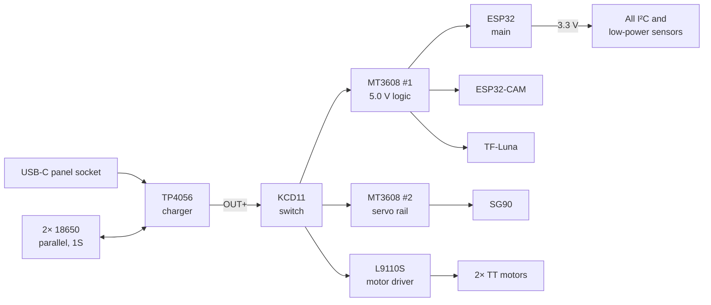
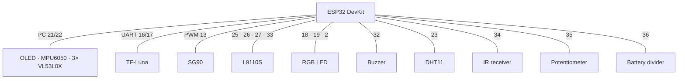

# 🛡️ Sentinel Robot Mini

### A small autonomous indoor patrol robot — built from scratch, one sensor at a time

*ESP32-based, fully 3D-printed, designed for home security and open to much more.*

 

-FF6B00?style=for-the-badge&logo=autodesk&logoColor=white&labelColor=555)

**English** · [Italiano](README.it.md)

---

<!-- Replace with your own images (suggested folder: docs/images/) -->

  
  
  

<i>CAD render · assembled robot · internals (work in progress)</i>

---

## ✨ What it is

**Sentinel Robot Mini** is a compact autonomous robot (about 18 cm wide) that patrols indoor spaces. It drives around the house, avoids obstacles, streams live video over its own Wi-Fi network and monitors the environment.

Home security is the core use case, but the robot is designed as a **general-purpose platform**: sensors, power and firmware are modular, so new behaviours can be added later without redesigning the hardware.

## 🎯 Goals

- **Learn robotics properly**: mechanical design, power electronics, sensor fusion and firmware, with every decision tested and measured rather than assumed.
- **Build a working home-security prototype**: autonomous patrol, live camera, environmental monitoring.
- **Keep it extensible**: a base that can grow into other projects.

## 🧭 Features

| Feature | Status |
|---|---|
| Live video stream (own Wi-Fi access point, ~6 fps VGA) | ✅ Working |
| Rotating head with camera and long-range lidar | ✅ Servo tested |
| Short-range obstacle detection (3× time-of-flight sensors) | 🔧 1 of 3 mounted and tested |
| Orientation tracking (gyro + accelerometer) | ✅ Tested |
| On-board OLED status display | ✅ Tested |
| Rechargeable battery with USB-C charging | ✅ Working |
| Temperature monitoring and reaction | 📝 Planned |
| Autonomous patrol | 📝 Planned |
| Motion detection | 📝 Planned |
| IR remote control | 📝 Planned |
| Over-the-air updates for the camera | 📝 Planned |

## 🔩 Hardware

### Sensors and why each one is there

| Sensor | Role |
|---|---|
| **TF-Luna** (lidar) | Long-range distance, mounted on a rotating crown to scan the room |
| **3× VL53L0X** (time-of-flight) | Short-range obstacle detection: front-right, front-left, rear |
| **MPU6050** (IMU) | Heading and turn angles |
| **OV2640** on ESP32-CAM | Live video stream |
| **DHT11** | Temperature and humidity |
| **VS1838B** | IR remote receiver |
| **Potentiometer** | Manual max-speed limit (fully left = stopped) |

### Bill of materials

| Qty | Component | Notes |
|:-:|---|---|
| 1 | ESP32 DevKit (WROOM) | Main controller |
| 1 | ESP32-CAM (OV2640) | In the head, streams video |
| 1 | TF-Luna lidar | UART, on the rotating crown |
| 1 | SG90 micro servo | Rotates the head and the lidar crown |
| 2 | TT gear motors + 65 mm wheels | Differential drive, 130 mm track |
| 1 | L9110S motor driver | |
| 1 | CY-12A ball caster | Rear support |
| 3 | VL53L0X modules | On custom tilted 3D-printed adapters |
| 1 | MPU6050 | I²C |
| 1 | SSD1306 OLED 128×64 | I²C |
| 1 | DHT11 | |
| 1 | VS1838B IR receiver | |
| 1 | Potentiometer | |
| 1 | RGB LED + 3× 220 Ω resistors | Status light |
| 1 | Buzzer | |
| 2 | 18650 Li-ion cells | In parallel (1S) |
| 1 | TP4056 USB-C charger module | |
| 2 | MT3608 boost converters | Logic rail and servo rail |
| 1 | USB-C panel-mount socket | Charging port |
| 1 | KCD11 rocker switch | Main power |
| — | M3 heat-set inserts, 22 AWG wire, heat-shrink | |

### Mechanical design

- 12-sided body, Ø 170 mm, 2.4 mm walls, printed in **PETG** on a Bambu Lab A1 mini (180 × 180 mm bed).
- Fully **parametric model in Fusion**, generated by a Python script.
- Head on a turret: camera inside, servo on top, lidar crown above it.
- Custom **tilted sensor adapters** for the VL53L0X (see *Lessons learned*).

## ⚡ Power

All grounds are common. The ESP32 measures the battery voltage through a 100k/100k divider.

## 📌 Pinout (ESP32 main)

| GPIO | Function |
|---|---|
| 21 / 22 | I²C SDA / SCL (OLED `0x3C`, MPU6050 `0x68`, VL53L0X `0x30–0x32`) |
| 4, 14 | VL53L0X XSHUT lines |
| 16 / 17 | TF-Luna UART |
| 13 | Servo |
| 25, 26, 27, 33 | L9110S motor inputs |
| 18, 19, 2 | RGB LED |
| 32 | Buzzer |
| 23 | DHT11 |
| 34 | IR receiver |
| 35 | Potentiometer |
| 36 | Battery voltage (divider) |

## 🧠 Lessons learned

**The floor problem.** With the front sensors 32 mm above the ground and mounted straight, they always read about 148 mm, because their ~25° cone was hitting the floor. The fix took several printed iterations:

| Version | Change | Result |
|---|---|---|
| v2 | Straight mount | Perfect fit, but still sees the floor |
| v3 | Tilted 15° up | Collided with an internal mounting post |
| **v4** | 15° up + a step for 2.3 mm clearance | ✅ Wall at ~96 cm, stable ±4 mm |
| v5 | 22° up | Spare, not needed |

The final rule: the VL53L0X sensors only flag obstacles **closer than 30 cm**. Long range is the lidar's job.

**Three sensors, one I²C address.** All VL53L0X modules ship at `0x29`. With two powered at once the bus failed and readings got mixed up. The fix is a boot sequence: hold the sensors in reset with XSHUT, then wake them one at a time and give each a new address (`0x30`, `0x31`, `0x32`). One sensor has no XSHUT line, so the firmware must also handle a soft reset where it already holds its new address.

**ESP32-CAM reboot loop.** The camera kept restarting under load: the brownout detector was tripping on supply dips. Disabling it confirmed the cause; the real fix is a stable 5 V rail with a bulk capacitor, after which the detector goes back on.

**Other small ones:** "camera not supported" turned out to be the ribbon cable or the XCLK frequency; the OLED is mounted upside down and needs a 180° rotation in software.

## 🗺️ Roadmap

- [x] Body design and printing
- [x] Power system with USB-C charging
- [x] Camera live stream
- [x] Servo, OLED and IMU tested
- [x] Front-right distance sensor with tilted adapter
- [ ] Left and rear distance sensors
- [ ] Remaining wiring (motors, lid controls, turret)
- [ ] Main firmware: sensor filtering, speed ramps, status LED
- [ ] Autonomous patrol
- [ ] Temperature reaction
- [ ] Motion detection
- [ ] IR remote control
- [ ] Final sensor calibration

## 📁 Repository contents

> Work in progress: only selected parts of the code are published.

## 👤 Author

**Stefano**, 17-year-old maker from Italy. Started late September 2026, about 30 hours of work so far.

- GitHub: *(this profile)*
- LinkedIn: *(coming soon)*

## 📄 License

© 2026 Stefano. **All rights reserved.**

This repository is public for viewing and learning only. No part of it (code, 3D models, images, documentation) may be copied, modified, redistributed or used commercially without written permission from the author.
